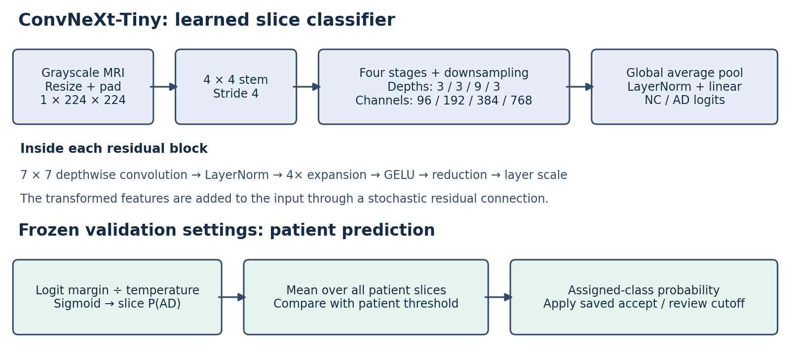
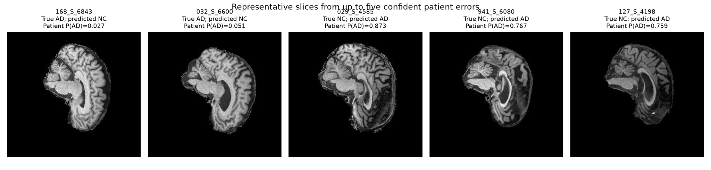
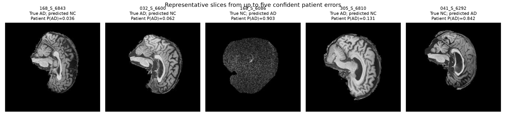
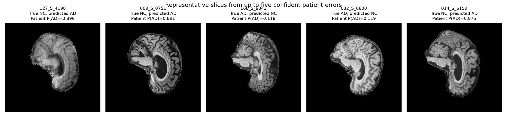
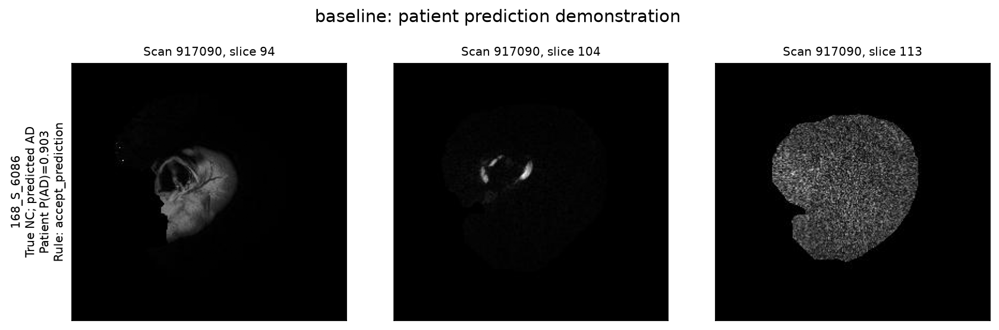

# ConvNeXt-Tiny for ADNI classification: accuracy, confidence and computational cost

**Author:** Sheung Yan (Gaster) Chiang — s4862630  
**Course:** COMP3710, 2026  
**Task:** Hard difficulty, AD versus normal control (NC; also called CN in the brief)

> **Draft status:** Results below are from completed Rangpur experiments. Python/package versions and training configurations have been confirmed from the supplied Rangpur outputs. The feasibility consultation has been completed, as reported by the student. The tutor confirmed that pretrained weights are permitted and suggested further tuning of the scratch-trained ConvNeXt; the additional experiment is planned and has not yet produced results. The final pretrained-model failure figure and patient CSV have been audited and incorporated.

## 1. Problem and main finding

This project compares a single-channel ConvNeXt-Tiny classifier with a smaller conventional CNN on ADNI brain MRI slices. The prototype predicts Alzheimer’s disease (AD) or normal control (NC), combines predictions across slices, and tests whether calibrated probabilities can identify cases needing human review. The engineering question is whether the larger architecture improves useful predictions and confidence enough to justify its extra computing cost.

Three experiments are reported: a scratch-trained baseline, scratch-trained ConvNeXt, and a pretrained ConvNeXt fine-tuning experiment. With frozen validation-selected settings, patient test accuracy is **82.35%, 71.57% and 91.18%**, respectively. The final pretrained ConvNeXt correctly classifies **93/102 patients**, with seven NC false positives and two AD false negatives. Its patient macro-F1 is **0.9028**, AUROC **0.9517**, and AD recall **0.9394**.

**The final pretrained ConvNeXt meets the assignment's minimum 80% test accuracy at slice, scan and patient levels**, both at raw threshold 0.5 and with the saved validation-selected thresholds. The earlier scratch ConvNeXt did not meet the target and remains in this report as a developmental comparison.

The baseline and scratch ConvNeXt rejection rules failed the experimental 90% accepted-case accuracy target. The final pretrained run reaches **91.18% accuracy with 100% coverage**, because validation selects a zero rejection cutoff. This meets the chosen empirical point target but does not demonstrate useful uncertainty-based routing: every patient, including all nine errors, is accepted. The final model supports further research development rather than a claim of validated clinical automation.

## 2. Working principles

A convolution learns small spatial filters that respond to local image patterns. Stacking layers combines these into more complex features. The baseline uses four convolution, BatchNorm, ReLU and max-pooling blocks with 32, 64, 128 and 256 channels, followed by global average pooling, dropout (0.30) and a two-class linear output.

ConvNeXt modernizes this approach using residual blocks, large depthwise convolutions and channel mixing [1]. Each implemented block applies a 7×7 depthwise convolution, LayerNorm, fourfold channel expansion, GELU, channel reduction, layer scaling and a residual connection with stochastic depth. The Tiny configuration has stage depths (3, 3, 9, 3) and channels (96, 192, 384, 768). A 4×4 stride-4 stem and three downsampling layers reduce spatial resolution; global average pooling, final normalization and a linear layer produce two logits. The implementation uses a one-channel input and two-class output. The first experiment trains from scratch; the final experiment initializes the same custom backbone from torchvision ImageNet-1K weights [5] and fine-tunes it on ADNI. It does not replace the custom model with torchvision inference code.



*Figure 1. Architecture and prediction flow. Calibration is fitted on validation patients; the same settings are then applied to held-out test patients.*

For a slice with logits z_NC and z_AD, its AD probability is:

```text
p_AD = sigmoid(z_AD - z_NC)
p_AD_calibrated = sigmoid((z_AD - z_NC) / T)
```

Here T is a positive temperature fitted using validation patient negative log-likelihood (NLL), following the temperature-scaling idea in [2]. Calibration is applied to each slice before averaging. Scan and patient probabilities are the arithmetic mean of all their slice probabilities. In scratch training, patients with more scans contribute more training slices. The final fine-tuning experiment samples slices with probability inversely proportional to their patient's slice count, giving equal expected sampling mass per patient. Evaluation still averages all available slices and counts each patient once. With 20 slices per scan, patient averaging is also equivalent to averaging that patient's scan means.

A prediction is AD when its probability reaches the threshold selected for that aggregation level. Temperature controls probability sharpness; the decision threshold controls the class decision. These are separate operations. A positive temperature preserves slice ranking and the slice decision at threshold 0.5, but averaging transformed probabilities can change scan or patient ranking and decisions.

## 3. Data audit, split and preprocessing

Data are read from the course-provided ADNI files:

```text
/home/groups/comp3710/ADNI/AD_NC
/home/groups/comp3710/ADNI/meta_data_with_label.json
```

The audit identified **30,520 JPEG slices, 1,526 scans and 680 patients**, with 20 slices per scan. Images are 256×240 pixels (width × height). Filenames identify the scan and slice; metadata link scans to patients and labels. Metadata label 0 (NC) is mapped to output 0 and label 2 (AD) to output 1. No conflicting patient labels were identified in the audit.

The supplied training and testing folders had no shared scans but shared **216 patients**. Using those folders directly would allow the model to see the same person during training and testing. The implementation therefore pools their records and constructs a seeded, class-stratified patient split. All scans and slices belonging to one patient remain in one split. Assertions check that both patient and scan sets are disjoint.

| Split | Patients | NC patients | AD patients | Scans | Slices |
|---|---:|---:|---:|---:|---:|
| Train | 476 | 321 | 155 | 1,065 | 21,300 |
| Validation | 102 | 69 | 33 | 228 | 4,560 |
| Test | 102 | 69 | 33 | 233 | 4,660 |
| Total | 680 | 459 | 221 | 1,526 | 30,520 |

The approximate ratio is 70/15/15, using seed **3710**. Patient classification is the primary operating unit; slice and scan results are also reported. The test set contains 69 NC and 33 AD patients, so accuracy alone can conceal poor AD recall. Slices from the same patient are correlated and should not be treated as independent clinical cases.

Preprocessing converts each image to grayscale, resizes it to 224×210, pads seven black pixels above and below, converts it to a tensor, and normalizes with mean 0.5 and standard deviation 0.5. This preserves the original aspect ratio. Training additionally uses random affine augmentation: rotation within ±5°, translation within 2%, and scale 0.98–1.02. Validation and test transformations are deterministic. This is a project-specific preprocessing choice, not a claim of reproducing the original ConvNeXt ImageNet recipe. No new skull stripping, intensity standardization across scans or 3D registration is performed by this code.

## 4. Feasibility review

### User need and scope

The intended user is an imaging specialist reviewing screening predictions. The prototype investigates AD/NC classification and whether confidence can flag ambiguous cases. It processes supplied 2D JPEG slices and evaluates patient-level outputs. It does not establish clinical diagnosis or validated clinical automation.

| Testable criterion for this review | Evidence or present status |
|---|---|
| No shared patients or scans across train, validation and test | Split assertions and audited counts support this criterion |
| ConvNeXt test accuracy at least 0.80, as required by the brief | Met by pretrained ConvNeXt: raw slice 0.8818, scan 0.9270, patient 0.9118; scratch run did not meet it |
| Compare patient accuracy, macro-F1, per-class metrics and AUROC against the same-split baseline | Completed; pretrained ConvNeXt is stronger overall, while baseline is much cheaper |
| Experimental accepted-case accuracy at least 0.90 with coverage at least 0.50 | Pretrained run reaches 0.9118 test accuracy at 1.0 coverage, but the zero cutoff rejects no cases; scratch rules fail the accuracy target |
| Proposed peak allocated training VRAM budget below 4 GiB on one A100 | Observed peaks below 4 GiB; this retrospective budget is not evidence of a pre-agreed criterion |

### Model choice and course concepts

ConvNeXt-Tiny is the hard-difficulty model specified for ADNI. Convolution provides a useful local spatial bias; residual connections and normalization support deeper optimization. The smaller CNN provides a lower-cost comparison. Cross-entropy, gradient-based learning, augmentation, regularization, model selection and patient-separated evaluation connect the implementation to course concepts. A larger network does not automatically generalize better on a limited patient cohort.

### Evidence, risks, computing budget and fallback

The data audit makes the experiment feasible but exposes patient leakage in the supplied folder split. All three training runs fit on one A100, with recorded training-loop times of approximately 5.31 minutes for baseline, 19.65 minutes for scratch ConvNeXt and 17.54 minutes for pretrained ConvNeXt. The main risks are limited independent patients, correlated slices, image-quality variation, overfitting and confident errors. Only one seed per training recipe has been measured.

The completed development experiment combines pretrained initialization, conservative fine-tuning, patient-uniform sampling and light label smoothing. A practical next investigation is to verify its remaining false negatives and image-quality sensitivity, with a fixed GPU budget and development decisions made using validation data. Any new evaluation should acknowledge that the current test set has already been examined; fresh independent patients are needed for a new confirmatory claim. The fallback is to retain the simpler baseline as a research prototype and require human review, rather than claim that its acceptance rule meets the 90% test target.

### Tutor feedback and planned response

During the feasibility consultation, I explained the data preprocessing, model choice, training process and results. The tutor described the work as solid, confirmed that using pretrained parameter weights is permitted, and suggested further tuning of ConvNeXt trained from scratch.

In response, I plan a controlled scratch-training experiment using random initialization. A proposed first comparison lowers the initial learning rate from 0.0003 to 0.0001 while keeping the patient split, seed, preprocessing, weight decay and other settings fixed. This learning-rate choice is a project response to the feedback, not a setting prescribed by the tutor. I will compare validation patient macro-F1, AD recall and training/validation curves, preserving the existing runs as references. A lower learning rate is not guaranteed to improve generalization.

**Experiment status:** planned, not yet run or evaluated. All numerical results elsewhere in this report remain those of the three completed experiments. Any additional checkpoint and operating settings will be selected using validation data rather than repeated test-set tuning. The previously examined test cohort remains a limitation for confirmatory evaluation.

## 5. Training and evaluation protocol

Both models use the same records, preprocessing, seed and full evaluation splits. Training uses cross-entropy and AdamW with cosine learning-rate decay. The training budget is 30 epochs, batch size 32, two data-loader workers, 224×224 input, CUDA mixed precision and early stopping after eight epochs without improvement. Checkpoints are selected by validation patient macro-F1 at the training threshold 0.5.

The following scratch-run values are confirmed by the saved `configuration.json` files from both runs. They also match the supplied code defaults. Both configurations record `skip_test=true`, `no_amp=false`, `profile_batches=20`, and no training or evaluation batch caps.

| Setting | Baseline scratch | ConvNeXt scratch |
|---|---:|---:|
| Initial learning rate | 0.001 | 0.0003 |
| Weight decay | 0.0001 | 0.05 |
| Selected epoch | 6 | 18 |
| Last training epoch | 14 | 26 |
| Input channels / output classes | 1 / 2 | 1 / 2 |
| Pretraining | None | None |

ConvNeXt's last training epoch reached slice accuracy 0.9822 while validation loss remained 1.0724, consistent with a substantial generalization gap. This does not prove its exact cause. The selected epoch, rather than the last epoch, supplies the weights for final evaluation.

### Final pretrained fine-tuning experiment

Run `convnext_pretrained_seed3710_648764` uses the same custom ConvNeXt-Tiny, seed 3710, patient split, image preprocessing, batch size 32 and two workers. It transfers all backbone tensors from torchvision `ConvNeXt_Tiny_Weights.IMAGENET1K_V1` [5]. RGB stem kernels are summed to obtain a single-channel kernel, equivalent to repeating the same normalized grayscale image over three channels. The ImageNet classifier is discarded and the two-class head retains its fresh initialization. The original MRI normalization is retained; this is not torchvision's recommended RGB inference transform recipe.

Before training, a numerical check compares the custom backbone features with the official model's features for repeated grayscale input. A missing key, tensor shape mismatch, incomplete transfer or failed feature comparison aborts training. The completed run and its `transfer_verification.json` provide evidence that this guard passed.

| Fine-tuning setting | Value |
|---|---|
| Maximum epochs / head-only epochs | 30 / 2 |
| Initial backbone learning rate after unfreezing | 0.00005 |
| Initial head learning rate | 0.00025 |
| Weight decay / label smoothing | 0.01 / 0.05 |
| Sampling | Patient-uniform expected mass; replacement; original patient class prior retained |
| Learning-rate schedule | Cosine decay during fine-tuning to 10% of initial rates |
| Early-stopping patience | 8 fine-tuning epochs without patient macro-F1 improvement |
| Selected epoch / last epoch | 16 / 24 |
| Selection metric | Validation patient macro-F1 at threshold 0.5 |

Label smoothing is used for the training loss; validation loss uses ordinary cross-entropy. Sampling with replacement makes an epoch's sample count different from unique image coverage. At epoch 16, validation accuracy is 0.8811 (slice), 0.9123 (scan) and 0.9216 (patient), with patient macro-F1 0.9089. Training excludes test-image inference and profiles validation images after loading the best checkpoint.

The fine-tuning recipe changes several factors together, including access to ImageNet pretraining. This is a practical development experiment, not an ablation demonstrating that any single change caused the improvement. The baseline has not received equivalent pretraining, so the final comparison is between complete training pipelines rather than architecture alone.

The Rangpur training version uses `--skip-test` so that training does not evaluate test patients. Calibration is subsequently fitted using validation patients only. A scalar temperature minimizes validation patient NLL. Separate thresholds for slice, scan and patient predictions maximize validation macro-F1 over a grid from 0 to 1 in steps of 0.005, with ties resolved toward 0.5. The same validation set also selected the checkpoint, so validation calibration and threshold performance are optimistic; there is no independent calibration set.

| Validation-fitted setting | Baseline scratch | ConvNeXt scratch | ConvNeXt pretrained |
|---|---:|---:|---:|
| Temperature | 1.010741 | 1.485609 | 1.037258 |
| Slice AD threshold | 0.300 | 0.380 | 0.660 |
| Scan AD threshold | 0.365 | 0.420 | 0.445 |
| Patient AD threshold | 0.380 | 0.400 | 0.500 |
| Patient acceptance cutoff | 0.500 | 0.730 | 0.000 |

For patient rejection, assigned-class probability is p_AD for an AD prediction or 1−p_AD for an NC prediction. Validation selects the highest-coverage rule reaching 90% accepted accuracy and at least 50% coverage. A patient is routed to review when its assigned-class probability is below the saved cutoff. With a non-0.5 decision threshold, this quantity can be below 0.5 for the assigned AD class; it is not automatically the maximum class probability.

Checkpoint hashes, split manifests and inference precision are stored with calibration settings. Final testing checks these identities and applies the settings unchanged. Existing calibration and test reports are protected against accidental overwrite. The example demo subsequently loads the same weights and settings; it does not fit new parameters.

## 6. Held-out test results

**Raw:** uncalibrated probabilities with threshold 0.5. **Tuned:** temperature-scaled probabilities with validation-selected thresholds. Accuracy, recall and F1 are fractions. Each patient contributes one patient-level prediction.

| Model | Level | Variant | Accuracy | Macro-F1 | AUROC | AD recall |
|---|---|---|---:|---:|---:|---:|
| Baseline | Slice | Raw | 0.7655 | 0.7625 | 0.8807 | 0.6462 |
| Baseline | Slice | Tuned | 0.8174 | 0.8172 | 0.8807 | 0.8403 |
| Baseline | Scan | Raw | 0.7768 | 0.7733 | 0.9122 | 0.6441 |
| Baseline | Scan | Tuned | 0.8670 | 0.8669 | 0.9125 | 0.8729 |
| Baseline | Patient | Raw | 0.7941 | 0.7444 | 0.8595 | 0.5455 |
| Baseline | Patient | Tuned | 0.8235 | 0.7984 | 0.8595 | 0.7273 |
| ConvNeXt scratch | Slice | Raw | 0.7292 | 0.7285 | 0.7996 | 0.7691 |
| ConvNeXt scratch | Slice | Tuned | 0.7296 | 0.7276 | 0.7996 | 0.8042 |
| ConvNeXt scratch | Scan | Raw | 0.7597 | 0.7591 | 0.8479 | 0.7966 |
| ConvNeXt scratch | Scan | Tuned | 0.7682 | 0.7655 | 0.8481 | 0.8644 |
| ConvNeXt scratch | Patient | Raw | 0.7353 | 0.7153 | 0.8406 | 0.7273 |
| ConvNeXt scratch | Patient | Tuned | 0.7157 | 0.7005 | 0.8432 | 0.7576 |
| ConvNeXt pretrained | Slice | Raw | 0.8818 | 0.8816 | 0.9402 | 0.9017 |
| ConvNeXt pretrained | Slice | Tuned | 0.8815 | 0.8815 | 0.9402 | 0.8894 |
| ConvNeXt pretrained | Scan | Raw | 0.9270 | 0.9268 | 0.9699 | 0.9661 |
| ConvNeXt pretrained | Scan | Tuned | 0.9185 | 0.9181 | 0.9699 | 0.9746 |
| ConvNeXt pretrained | Patient | Raw | 0.9118 | 0.9028 | 0.9517 | 0.9394 |
| ConvNeXt pretrained | Patient | Tuned | 0.9118 | 0.9028 | 0.9517 | 0.9394 |

The baseline's tuned patient threshold improves AD recall from 18/33 to 24/33, while NC false positives increase from six to nine. Scratch ConvNeXt tuning increases correctly classified AD patients from 24 to 25 but increases NC false positives from 18 to 21. Its validation threshold therefore does not improve test patient accuracy. These results are reported without selecting a new operating threshold on test labels.

For pretrained ConvNeXt, the patient threshold remains 0.5 and the raw/calibrated/tuned variants have identical class decisions. The frozen slice threshold 0.66 changes accuracy from 0.8818 to 0.8815, and scan threshold 0.445 changes it from 0.9270 to 0.9185 while increasing AD recall. The report retains both variants and does not retrospectively replace the saved thresholds because one test variant scores higher.

The current split was first tested with the scratch models before the fine-tuning experiment was developed. Fine-tuning and its operating settings use training/validation data, but these are results on a previously examined test cohort, not a new blinded confirmatory cohort.

### Patient per-class metrics

| Model / variant | NC precision | NC recall | NC F1 | AD precision | AD recall | AD F1 |
|---|---:|---:|---:|---:|---:|---:|
| Baseline / raw | 0.8077 | 0.9130 | 0.8571 | 0.7500 | 0.5455 | 0.6316 |
| Baseline / tuned | 0.8696 | 0.8696 | 0.8696 | 0.7273 | 0.7273 | 0.7273 |
| ConvNeXt scratch / raw | 0.8500 | 0.7391 | 0.7907 | 0.5714 | 0.7273 | 0.6400 |
| ConvNeXt scratch / tuned | 0.8571 | 0.6957 | 0.7680 | 0.5435 | 0.7576 | 0.6329 |
| ConvNeXt pretrained / all patient variants | 0.9688 | 0.8986 | 0.9323 | 0.8158 | 0.9394 | 0.8732 |

Tuned patient confusion counts:

| Model | True NC → NC | True NC → AD | True AD → NC | True AD → AD |
|---|---:|---:|---:|---:|
| Baseline | 60 | 9 | 9 | 24 |
| ConvNeXt scratch | 48 | 21 | 8 | 25 |
| ConvNeXt pretrained | 62 | 7 | 2 | 31 |

### Calibration and accepted-case performance

| Model | Patient NLL raw → calibrated | Brier raw → calibrated | AD-probability ECE raw → calibrated |
|---|---|---|---|
| Baseline | 0.45009 → 0.44985 | 0.14305 → 0.14304 | 0.09881 → 0.10290 |
| ConvNeXt scratch | 0.49348 → 0.48086 | 0.16564 → 0.16246 | 0.12761 → 0.13583 |
| ConvNeXt pretrained | 0.26397 → 0.26430 | 0.07533 → 0.07541 | 0.08424 → 0.08514 |

Lower NLL and Brier scores are better. Temperature scaling improves patient NLL and Brier for the scratch runs. In the pretrained run it improves slice NLL/Brier/ECE but slightly worsens all three at patient level: validation-fitted calibration is not guaranteed to improve a different evaluation cohort. The reported ECE is a **classwise AD-probability calibration error**, comparing mean P(AD) with the observed AD fraction within bins. It is not the usual maximum-class-confidence ECE. Its increase at patient level shows that calibration improvements depend on the metric and do not establish reliable rejection.

| Model | Validation accepted / total | Validation accepted accuracy | Test accepted / total | Test coverage | Test accepted accuracy | Test accepted errors |
|---|---:|---:|---:|---:|---:|---:|
| Baseline | 93 / 102 | 0.9032 | 93 / 102 | 0.9118 | 0.8387 | 15 |
| ConvNeXt scratch | 70 / 102 | 0.9000 | 68 / 102 | 0.6667 | 0.8382 | 11 |
| ConvNeXt pretrained | 102 / 102 | 0.9216 | 102 / 102 | 1.0000 | 0.9118 | 9 |

Both scratch-model rules met the validation target but failed it on test. The pretrained model already reached 90% validation accuracy without rejecting anyone, so the maximum-coverage selector chose cutoff 0. Its test accepted accuracy is therefore identical to ordinary patient accuracy: 93/102 (0.9118). This reaches the experimental point target but routes no ambiguous cases to review and retains all seven false positives and two false negatives. It does not demonstrate reliable uncertainty discrimination or establish a clinical safety guarantee. The 90% accuracy and 50% coverage criteria are project choices, not numerical requirements specified by the assignment.

## 7. Computational cost

| Measurement | Baseline scratch | ConvNeXt scratch | ConvNeXt pretrained |
|---|---:|---:|---:|
| Trainable parameters | 388,834 | 27,818,594 | 27,818,594 |
| Training-loop time, seconds | 318.60 | 1,179.01 | 1,052.23 |
| Peak allocated training GPU memory, MiB | 643.59 | 2,289.56 | 2,290.30 |
| Peak allocated inference GPU memory, MiB | 253.81 | 1,000.25 | 999.44 |
| Batched model inference, ms per slice | 0.1099 | 0.4605 | 0.4264 |
| Throughput, slices per second | 9,099.88 | 2,171.32 | 2,345.16 |
| Measured inference samples | 640 | 640 | 640 |

Profiling used CUDA on the A100 partition, batch size 32 and mixed precision. Twenty measured batches followed three warm-up batches. Timing synchronizes CUDA around the model forward pass and excludes loading, preprocessing, host-to-device transfer and patient aggregation. The per-slice value is batch time divided by sample count, not interactive single-image latency. Memory is PyTorch peak allocated memory, not total GPU utilization or reserved memory. The JSON field names use “MB”, but the code divides bytes by 1024², so this table correctly uses MiB.

Training time includes the epoch loop, validation and checkpoint/plot writing, but excludes initial dataset/model setup and the later inference profile. The peak inference figure can include allocations already resident from training; these are not separate clean-process deployment memory measurements. Relative to baseline, pretrained ConvNeXt has about **71.5×** as many parameters, **3.56×** peak allocated training memory and **3.88×** batched latency. Its training-loop time is about **3.30×** longer, reflecting different completed epoch counts as well as model cost. Pretraining download, ImageNet training cost and transfer verification are excluded from this ADNI training-loop timer. The final run explicitly profiles the validation split; these are representative throughput measurements rather than guaranteed application latency.

## 8. Qualitative failure analysis

### Final pretrained ConvNeXt (epoch 16)

The full test patient CSV contains 102 unique patients and reproduces the reported confusion matrix: 62 correctly classified NC, seven NC false positives, two AD false negatives and 31 correctly classified AD. The five panels below are selected confident errors, not a random sample. Scores are calibrated patient P(AD), using the frozen validation-selected temperature 1.0373 and patient threshold 0.5.



| Patient and true label | Prediction and P(AD) | Observed failure and interpretation | Follow-up investigation |
|---|---|---|---|
| 168_S_6843, AD | NC; 0.0273 | Confident false negative, with assigned NC probability 0.9727. This patient also failed in the baseline and scratch ConvNeXt. Pretraining does not resolve this recurring miss. | Verify source labels and all scan/slice scores; compare correctly classified AD development cases for quality or acquisition differences. |
| 032_S_6600, AD | NC; 0.0510 | Second confident false negative, with assigned NC probability 0.9490. Also missed by both earlier models. High classification confidence does not establish correctness. | Inspect variation across all scans and slice positions, and verify metadata. Test any explanation on validation data or a fresh cohort. |
| 029_S_4585, NC | AD; 0.8735 | Highest-confidence final-model false positive. The selected image alone does not identify the anatomical or acquisition feature responsible. | Compare per-scan scores, image quality and acquisition metadata with correctly classified NC cases. |
| 941_S_6080, NC | AD; 0.7667 | Confident false positive. The representative slice differs in visible brain extent and intensity from other panels; these are candidate covariates, not established triggers. | Audit slice-position alignment, foreground coverage and intensity distribution across full scans and development cases. |
| 127_S_4198, NC | AD; 0.7593 | Recurring false positive from scratch ConvNeXt, now with a lower AD score but still above 0.5. The representative image appears darker than several other panels. | Evaluate intensity and image-quality sensitivity with validation data; determine whether the pattern extends beyond the displayed slice. |

All five errors pass the saved rejection cutoff of zero. The two AD misses account for all final-model patient false negatives. The other four false positives are 006_S_4485 (0.6162), 014_S_6199 (0.5194), 129_S_4396 (0.6084) and 141_S_0767 (0.6059). The near-boundary case 014_S_6199 contrasts with the highly confident errors, showing that low-confidence review alone cannot capture every failure.

The figure shows original representative slices, not saliency maps. Patient means cannot establish that every constituent slice agrees. Image quality, slice position, limited learned disease features and acquisition shortcuts are hypotheses requiring additional evidence; these panels cannot establish a clinical cause. No thresholds or weights were changed after this error inspection.

### Earlier scratch-model comparisons

The following figures and probabilities belong to the baseline and epoch-18 scratch ConvNeXt. They provide developmental comparisons and must not be relabeled as final pretrained results.

The failure figures show selected confident patient-level errors. A representative slice is chosen near its patient's mean probability; this does not identify a causal anatomical feature. These examples are deliberately selected for error analysis and do not estimate population error frequency. Visual hypotheses below need further checks against the source images and complete scans.





| Case | Observed result | Failure mode and interpretation | Follow-up needed |
|---|---|---|---|
| 168_S_6843, true AD | Baseline P(AD) ≈0.036; ConvNeXt ≈0.118; both predict NC | Shared confident false negative. Agreement between architectures does not establish correctness, and both saved rules accept the incorrect predictions. | Inspect every scan/slice and verify metadata; test whether image quality or weak learned disease features explain the error. |
| 032_S_6600, true AD | Baseline P(AD) ≈0.062; ConvNeXt ≈0.119; both predict NC | A second shared false negative. The failure survives both aggregation and rejection; averaging is not enough when model evidence is consistently wrong. | Review per-scan variation and compare with correctly classified AD cases without changing test thresholds. |
| 168_S_6086, true NC | Baseline P(AD)=0.9032, wrong; ConvNeXt P(AD)=0.0117, correct | Confident architecture disagreement. The displayed slices are unusually dark or noisy. Quality sensitivity is a plausible hypothesis, not an established cause. | Inspect original JPEGs, intensities and the full scan; assess quality effects using validation data. |
| 041_S_6292, true NC | Baseline P(AD) ≈0.842; predicts AD | Confident false positive accepted by the baseline rule. A high AD score is not sufficient evidence of disease. No causal image feature is established from the figure. | Compare slice and scan scores, check image quality and test for acquisition-related shortcuts. |
| 127_S_4198, true NC | ConvNeXt P(AD) ≈0.896; predicts AD | Confident false positive accepted by the ConvNeXt rule. Lower visible sharpness in the representative image warrants a quality check but does not prove the trigger. | Review complete scan images and quality distribution relative to correctly classified NC validation patients. |

### Detailed disagreement demonstration




For patient **168_S_6086**, scan **917090**, the CSV audit includes 20 slices. Baseline's calibrated AD probabilities range from **0.693 to 0.990**, with a mean about 0.903; ConvNeXt's range from **0.000 to 0.084**, with a mean about 0.012. Every baseline slice exceeds its saved AD slice threshold 0.30; every ConvNeXt slice is below its threshold 0.38. The disagreement therefore extends across the whole scan rather than one selected slice. Both patient predictions pass their saved acceptance cutoffs, even though baseline is wrong.

The demo figures display evenly spaced slices 94, 104 and 113. They are original image examples, not attention maps or explanations of the model's internal decision. The scratch ConvNeXt's success on this case shows complementary behavior despite its weaker aggregate performance. The final pretrained patient CSV also classifies this patient correctly as NC; the displayed demo images and probabilities remain scratch-model results.

## 9. Recommendation and limitations

For further research development, prefer the **pretrained ConvNeXt pipeline** when the measured GPU cost is acceptable. Compared with tuned baseline, it increases patient accuracy by **8.82 percentage points**, patient macro-F1 by approximately 0.1044 and AD recall by **21.21 percentage points**. It reduces AD false negatives from nine to two and NC false positives from nine to seven. The baseline remains a much cheaper operational reference, with approximately one quarter of the batched forward latency and one seventy-first of the parameters.

This is evidence for a stronger complete training pipeline, not proof that the ConvNeXt architecture alone causes the gain. The pretrained pipeline uses external ImageNet knowledge, a different optimizer schedule, label smoothing and patient-uniform sampling. A pretraining-matched baseline and controlled ablations have not been measured.

Do not interpret the zero rejection cutoff as successful confidence triage or clinical safety: it accepts all test patients, including the two AD false negatives. Further work should inspect these errors, audit image quality and investigate whether an independent calibration cohort improves uncertainty routing. The shared validation set selected the checkpoint, temperature and operating rules, making development scores optimistic.

This study has one seed per recipe, 102 test patients, no external cohort and no verified site/scanner-stratified analysis. The same test cohort was examined before the final development experiment, so independent patients are needed for a new confirmatory claim. Patient separation prevents identity leakage but does not ensure acquisition robustness. The prototype uses 2D JPEGs and does not constitute clinical validation.

## 10. Files and reproduction

| File | Purpose |
|---|---|
| `modules.py` | Baseline CNN and single-channel ConvNeXt-Tiny implementations |
| `dataset.py` | Metadata parsing, patient split, leakage checks and transforms |
| `train.py` | Scratch training and shared training/evaluation utilities |
| `convnext_transfer.py` | Official pretrained backbone transfer and feature-equivalence verification |
| `train_convnext_finetune.py` | Validation-selected pretrained fine-tuning, sampling and profiling |
| `convnext_finetune.slurm` | Smoke and full GPU training jobs |
| `convnext_finetune_evaluate.slurm` | Calibration or frozen testing of a specified fine-tuning job |
| `evaluate_models.py` | Validation-only calibration and frozen final evaluation |
| `evaluate_models.slurm` | GPU evaluation jobs for both checkpoints |
| `predict.py` | Selected-patient inference using saved weights and calibration |
| `predict_demo.slurm` | Baseline/ConvNeXt example on patient 168_S_6086 |
| `requirements-lock.txt` | Exact package snapshot from the Rangpur experiment environment |
| `figures/` | Report figures |

### Recorded environment

The experiment virtual environment is `~/comp3710/venvs/convnext-report`. The versions below are recorded from the supplied Rangpur `python --version` and `pip freeze` outputs, rather than the report-generation environment.

| Component | Recorded version |
|---|---|
| Python | 3.11.13 |
| PyTorch | 2.14.1 |
| torchvision | 0.29.1 |
| NumPy | 2.4.6 |
| SciPy | 1.17.1 |
| scikit-learn | 1.9.1 |
| Matplotlib | 3.11.2 |
| Pillow | 12.3.0 |
| Installed CUDA toolkit package | 13.0.3.0 |
| Installed NVIDIA CUDA runtime package | 13.0.96 |
| Installed NVIDIA cuDNN package | 9.24.0.43 |

The full 46-package snapshot is included in `requirements-lock.txt`. Installed CUDA/cuDNN package versions do not independently establish the versions actually loaded by PyTorch. Those runtime values and the GPU driver version have not yet been captured. The core package versions are transcribed from the user's experiment output; no fresh installation of this environment has been tested.

To record or inspect the environment on Rangpur:

```bash
source ~/comp3710/venvs/convnext-report/bin/activate
cd ~/comp3710/PatternAnalysis-2026/recognition/ConvNeXt_s4862630
python --version
python -m pip freeze > requirements-lock.txt
python -c 'import torch; print("PyTorch", torch.__version__); print("CUDA runtime", torch.version.cuda); print("cuDNN", torch.backends.cudnn.version())'
cat outputs/baseline_seed3710/configuration.json
cat outputs/convnext_seed3710/configuration.json
```

Python and package versions above are already recorded. Capture the PyTorch CUDA/cuDNN runtime values with the command above and GPU model/driver with `nvidia-smi` inside a GPU allocation. `requirements-lock.txt` records packages; reproducing a compatible CUDA installation still requires the matching PyTorch wheel source/platform.

### Training

Submit GPU work through Slurm, not on the login node. The following reproduction arguments match the supplied saved run configurations. Run each within an A100 allocation, with four CPUs and two workers. Rangpur scripts omit an explicit `--mem` directive because the cluster rejected the earlier memory configuration.

```bash
python -u train.py --model baseline --epochs 30 --batch-size 32 \
  --workers 2 --seed 3710 --patience 8 --device cuda --skip-test \
  --output-dir outputs/baseline_seed3710

python -u train.py --model convnext --epochs 30 --batch-size 32 \
  --workers 2 --seed 3710 --patience 8 --device cuda --skip-test \
  --output-dir outputs/convnext_seed3710
```

Use a fresh output directory for a reproduction run so the recorded experiment is preserved. Both commands require the current Rangpur `train.py` version supporting `--skip-test`. Seeding and deterministic cuDNN settings improve repeatability but do not promise identical results across hardware or library versions.

### Final pretrained run

First cache the official weights without training on the login node, then submit GPU jobs:

```bash
python train_convnext_finetune.py --download-only
smoke_job_id=$(sbatch --parsable convnext_finetune.slurm smoke)
ft_job_id=$(sbatch --parsable --dependency=afterok:${smoke_job_id} convnext_finetune.slurm train)
cal_job_id=$(sbatch --parsable --dependency=afterok:${ft_job_id} convnext_finetune_evaluate.slurm "$ft_job_id" calibrate)
# Inspect calibration output after completion before running frozen test inference.
sbatch convnext_finetune_evaluate.slurm "$ft_job_id" test
```

Do not run test immediately while calibration is still pending. Recorded fine-tuning job **648764** selected epoch 16 and stopped at epoch 24. Its evaluation folder is `outputs/evaluation_convnext_pretrained_seed3710_648764`; recorded test job **648843** produced the results in this report. An attempted calibration refit (job 648838) was rejected by the overwrite guard because saved settings already existed. The saved epoch-16 calibration identity and full validation report were inspected before testing.

Final checkpoint SHA256: `1a66903d94c5b0b39ea6ee3df646b9fc8dda1737f58cddc0e16bf81faf3021eb`. Frozen temperature is 1.0372575213; thresholds are slice 0.66, scan 0.445 and patient 0.5. A reproduction should use new job-specific folders and retain the precision setting stored in calibration.

### Calibration, testing and demo

```bash
mkdir -p logs
sbatch evaluate_models.slurm calibrate
# Wait for successful calibration before submitting final evaluation.
sbatch evaluate_models.slurm test
# Existing calibration/test results are protected; do not rerun over them.
sbatch predict_demo.slurm 168_S_6086
```

The recorded calibration and final evaluation are already complete. To reproduce them, use fresh output locations in a copy of the evaluation job script. The demo uses a job-specific output directory and can be run without overwriting the original evaluation. It depends on `evaluate_models.py` being in the same project directory.

Example recorded output (job 648666):

```text
Model=baseline epoch=6 patients=['168_S_6086']
Patient 168_S_6086 | true=NC predicted=AD P(AD)=0.9032 action=accept_prediction
Model=convnext epoch=18 patients=['168_S_6086']
Patient 168_S_6086 | true=NC predicted=NC P(AD)=0.0117 action=accept_prediction
```

Training produces checkpoints, history, curves, configuration and resource profiles. Evaluation produces calibration settings, per-level metrics, slice CSVs, reliability/confusion figures, patient ROC/coverage plots and selected failure figures. Prediction produces `predictions.json`, slice/scan/patient CSV files and `prediction_examples.png`. Keep datasets and model checkpoints outside Git; commit code, environment records and the figures used in the report.

## 11. Artificial Intelligence Usage Disclosure

ChatGPT/Codex assisted with interpreting the assignment, explaining CNN and ConvNeXt concepts, scaffolding and debugging the Python implementation, designing the patient-level split and leakage checks, writing Slurm scripts, developing calibration/evaluation and prediction utilities, interpreting experiment outputs and drafting this report. Additional assistance covered pretrained tensor mapping, fine-tuning and patient-uniform sampling.

Verification included inspecting the supplied code and data-audit outputs, running the models and evaluation jobs on Rangpur, comparing printed metrics with saved JSON/CSV outputs, inspecting qualitative examples, and running the selected-patient demo with both checkpoints. The assistant performed local syntax, numerical and mocked orchestration checks for the evaluation and prediction utilities; those local checks did not exercise actual CUDA inference. The Rangpur runs supplied the real GPU evidence, including a successful fine-tuning smoke run and completed training/validation/test inference. The transfer utility automatically checks tensor coverage and numerical backbone equivalence before training. No claim is made that a comprehensive independent test suite or clinical validation was completed.

**Before submission, confirm that this disclosure matches the tools you actually used and the checks you personally completed.** The submitted implementation, numerical claims and final interpretation remain the student's responsibility.

## 12. References

1. Liu, Z., Mao, H., Wu, C.-Y., Feichtenhofer, C., Darrell, T. and Xie, S. (2022). *A ConvNet for the 2020s*. CVPR, pp. 11976–11986. [Paper](https://openaccess.thecvf.com/content/CVPR2022/html/Liu_A_ConvNet_for_the_2020s_CVPR_2022_paper.html). The architecture follows the ConvNeXt design with task-specific input/output changes and a smaller project training recipe.
2. Guo, C., Pleiss, G., Sun, Y. and Weinberger, K. Q. (2017). *On Calibration of Modern Neural Networks*. ICML, PMLR 70, pp. 1321–1330. [Paper](https://proceedings.mlr.press/v70/guo17a.html). Temperature scaling is adapted here to minimize validation patient NLL after slice aggregation.
3. COMP3710 teaching team (2026). *Working Prototype Project in the Era of Artificial Intelligence*, supplied draft v2 assignment brief. Requirements and domain investigation are taken from this supplied document; check the current course submission instructions before submitting.
4. Course-provided ADNI JPEG subset and `meta_data_with_label.json`, available under `/home/groups/comp3710/ADNI`. Dataset counts and split statistics are from the project audit; this report does not infer additional acquisition provenance beyond the supplied metadata.

5. PyTorch contributors. *Torchvision ConvNeXt-Tiny pretrained weights and model implementation*. [Documentation](https://docs.pytorch.org/vision/main/models/generated/torchvision.models.convnext_tiny.html) and [official source](https://github.com/pytorch/vision/blob/main/torchvision/models/convnext.py). ImageNet-1K V1 weights initialize the final custom-model backbone; torchvision key mapping and stem adaptation are documented in `convnext_transfer.py`.
